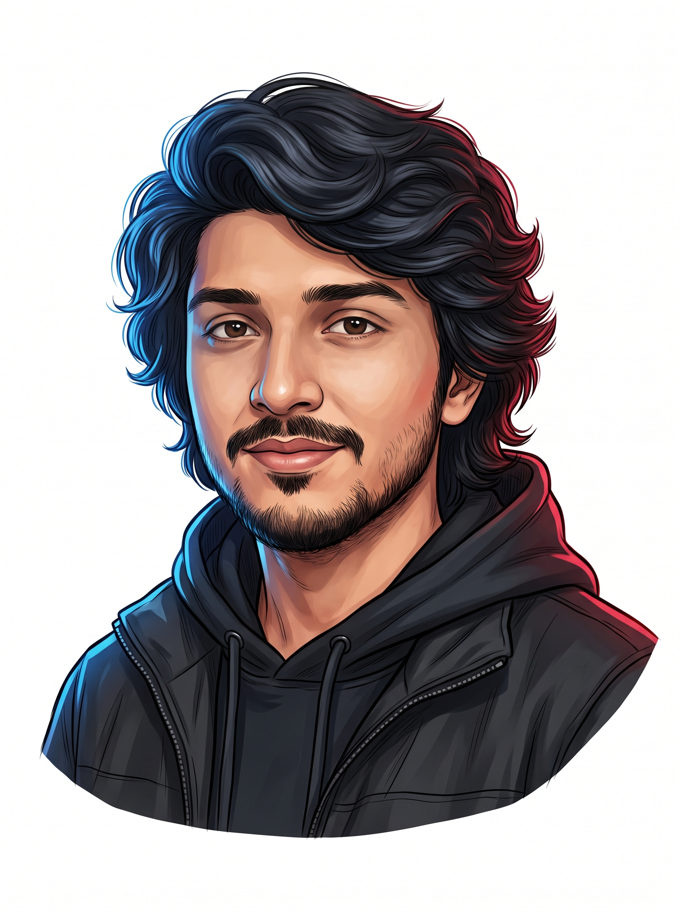
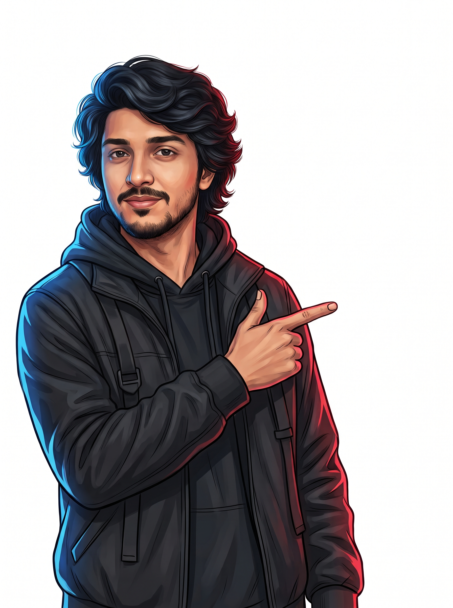

<div align="center">

# ⚡ MALIK ABUBAKAR ALI

### `CYBER SECURITY SCHOLAR • SECURITY TOOL BUILDER • OPERATIONS TEAM LEAD`

**`BakarCipher` — Learning the Attack. Engineering the Defense.**

[](https://linkedin.com/in/bakarcipher)
[](https://instagram.com/bakarcipher)
[](https://github.com/BakarCipher)
[](https://github.com/BakarCipher)

<br/>

`[ SYSTEM ONLINE ]` &nbsp; `◆ BLUE TEAM` &nbsp; `◆ RED TEAM` &nbsp; `◆ DIGITAL FORENSICS`

---

<!-- HERO SECTION: ORIGINAL IMAGE PATH PRESERVED -->

<table border="0" cellpadding="0" cellspacing="0" width="100%">
<tr>
<td width="70%" align="left">

### `root@bakarcipher:~$ whoami --verbose`

## 👨‍💻 Malik Abubakar Ali

**Cyber Security Student | Security Enthusiast | Team Lead**

I am a **BS Cyber Security student at Riphah International University**, passionate about understanding cyber threats, building security tools, and strengthening digital defenses.

My journey combines **academic learning, hands-on security labs, practical cybersecurity projects, and professional leadership experience**.

I focus on developing real-world skills in:

- 🛡️ Security Operations & Threat Detection
- 🔍 Ethical Hacking & Vulnerability Assessment
- 🌐 Network Security & Packet Analysis
- 🧬 Digital Forensics & Incident Response
- 💻 Secure Software & Security Tool Development

**Current Mission:** Transforming cybersecurity knowledge into practical, working security solutions.

`◆ Team Lead @ Ace Solutions`  
`◆ Riphah International University`  
`◆ Developer Brand: BakarCipher`

</td>
<td width="30%" align="center">

</td>
</tr>
</table>

<br/>

### `> INITIALIZING BAKARCIPHER IDENTITY SYSTEM...`

<!-- ORIGINAL ID DASHBOARD PATH PRESERVED -->


<br/>

---

## 🧭 MY CYBERSECURITY JOURNEY

*From writing my first programs to developing cybersecurity tools and exploring real-world defense operations.*

</div>

### `01 // THE FOUNDATION — LEARNING TO BUILD`

My journey started with programming, networking fundamentals, operating systems, and understanding how computers communicate.

I developed experience with **C, C++, Java, Python, C#, and web technologies**, while exploring networking concepts such as TCP/IP, subnetting, routing, switching, VLANs, and network troubleshooting.

**What I learned:** Before securing a system, you must understand how it works.

### `02 // ENTERING THE SECURITY WORLD`

As a Cyber Security student at **Riphah International University**, I began exploring practical offensive and defensive security techniques.

My academic labs introduced me to:

- Kali Linux and security testing environments
- Wireshark and TCP/IP packet inspection
- Nmap scanning and service enumeration
- Snort intrusion detection and custom rules
- Linux firewalls, UFW, and iptables
- Nessus vulnerability assessments
- Wazuh security monitoring
- Virtual machines and isolated security labs

**What I learned:** Cybersecurity is not just about tools. It is about understanding evidence, identifying weaknesses, and applying the right controls.

### `03 // BUILDING THE BAKARCIPHER ECOSYSTEM`

I started developing my own projects under the **BakarCipher** brand to turn technical knowledge into practical applications.

My project portfolio spans:

| Domain | Selected BakarCipher Projects |
|:---|:---|
| 🔴 Offensive Security | ReconX, WebSentinel, ADGuardian |
| 🔵 Defensive Security | SentinelSIEM, EndpointGuard, ThreatHunt |
| 🛡️ Incident Response | ThreatOrchestrator |
| 🔬 Digital Forensics | DiskTrace, MemoryScope, EvidenceVault |
| 🔐 Security Utilities | Password Strength Analyzer, SSL Checker, File Hash Calculator |
| 💻 Software Engineering | QuickBuy, Secure Messaging, InsuraVault |

These projects represent my practical learning journey, from designing interfaces and writing code to implementing security-related functionality.

### `04 // DEVELOPING REAL-WORLD DEFENSIVE SKILLS`

My practical training focuses on developing the mindset and technical abilities needed for security operations.

Areas of ongoing learning include:

**SOC Operations:** Log analysis, alert investigation, intrusion detection, and security monitoring.

**Ethical Hacking:** Reconnaissance, enumeration, vulnerability assessment, and controlled security testing.

**Network Defense:** Traffic analysis, firewall configuration, IDS rules, and network troubleshooting.

**Digital Forensics:** Evidence handling, disk investigation, memory analysis, and documentation.

**Career Direction:** Continuing to grow toward cybersecurity roles involving security operations, threat detection, and incident response.

<div align="center">

---

### `> LOADING DEFENSIVE CAPABILITIES...`

<!-- ORIGINAL ABOUT-LIFE PATH PRESERVED -->


<br/>

## ⚙️ SECURITY & ENGINEERING STACK

*The technologies and tools behind my learning, experiments, and projects.*

<!-- ORIGINAL STACK PATH PRESERVED -->


<br/>

---

## 🛡️ BAKARCIPHER // TECHNICAL CAPABILITY MATRIX

</div>

```text
┌──────────────────────────────────────────────────────────┐
│                 BAKARCIPHER SECURITY LAB                 │
│                 OPERATOR: MALIK ABUBAKAR                 │
├──────────────────────────────────────────────────────────┤
│                                                          │
│  [01] NETWORK SECURITY                                   │
│  ├── Wireshark / tcpdump / Tshark                         │
│  ├── Nmap / Network Reconnaissance                       │
│  ├── TCP/IP / VLANs / DHCP / OSPF                        │
│  └── Firewall Rules / UFW / iptables                     │
│                                                          │
│  [02] SECURITY OPERATIONS                                │
│  ├── Snort IDS / Custom Detection Rules                  │
│  ├── Wazuh Monitoring                                    │
│  ├── Log Analysis / Alert Investigation                  │
│  └── Threat Hunting / Incident Response                  │
│                                                          │
│  [03] OFFENSIVE SECURITY                                 │
│  ├── Kali Linux / Nmap / Metasploit                      │
│  ├── Vulnerability Assessment                            │
│  ├── Web Application Security Testing                    │
│  └── Authorized Lab-Based Security Testing               │
│                                                          │
│  [04] DIGITAL FORENSICS                                  │
│  ├── Disk Forensics                                      │
│  ├── Memory Analysis                                     │
│  ├── Evidence Documentation                              │
│  └── Chain-of-Custody Concepts                           │
│                                                          │
│  [05] SOFTWARE DEVELOPMENT                               │
│  ├── Python / C / C++ / Java / C#                        │
│  ├── HTML / CSS / JavaScript                             │
│  ├── React / Node.js / Flask                             │
│  └── SQL Databases / REST APIs                           │
│                                                          │
└──────────────────────────────────────────────────────────┘
```

<div align="center">

## 🚀 FEATURED PROJECT ECOSYSTEM

*Building security solutions, one project at a time.*

</div>

| Project | Focus | Technology / Concept |
|:---|:---|:---|
| 🛰️ **BakarCipher ReconX** | Network reconnaissance | Attack surface mapping |
| 🌐 **BakarCipher WebSentinel** | Web security | Security assessment |
| 🏢 **BakarCipher ADGuardian** | Active Directory | Security assessment lab |
| 📡 **BakarCipher SentinelSIEM** | Security monitoring | SIEM concepts |
| 🛡️ **BakarCipher EndpointGuard** | Endpoint protection | EDR concepts |
| 🔎 **BakarCipher ThreatHunt** | Threat hunting | SOC investigation |
| ⚡ **BakarCipher ThreatOrchestrator** | Incident response | Automation and threat intelligence |
| 💽 **BakarCipher DiskTrace** | Disk forensics | Forensic investigation |
| 🧠 **BakarCipher MemoryScope** | Memory forensics | Memory investigation |
| 🔐 **BakarCipher EvidenceVault** | Digital evidence | Chain-of-custody workflows |

> **Development philosophy:** Build functional security tools, test them in controlled environments, document the results, and continuously improve their reliability.

---

<div align="center">

## 🎯 CURRENT LEARNING OBJECTIVES

</div>

```bash
root@bakarcipher:~$ cat /home/bakarcipher/mission.txt

[+] Strengthen practical SOC investigation skills
[+] Improve network threat detection and traffic analysis
[+] Explore advanced threat hunting techniques
[+] Develop reliable security automation tools
[+] Expand digital forensics knowledge
[+] Improve secure coding and application security
[+] Document and publish BakarCipher projects

[*] STATUS: CONTINUOUS LEARNING
[*] MINDSET: LEARN → BUILD → TEST → DEFEND
```

<div align="center">

---

## 🤝 LET'S CONNECT

### `> ESTABLISHING SECURE HANDSHAKE...`

*Interested in cybersecurity, security research, software development, or technical collaboration? Let's connect.*

<!-- ORIGINAL CONNECT IMAGE PATH PRESERVED -->

<table border="0" cellpadding="0" cellspacing="0" width="100%">
<tr>
<td width="35%" align="center">

</td>
<td width="65%" align="left">

### `Initiate Network Handshake`

Open to discussing:

🛡️ Defensive Cybersecurity  
🔍 Ethical Hacking & Security Research  
🌐 Network Security & Architecture  
💻 Security Projects & Development  
🤝 Technical Collaboration

<br/>

[](https://linkedin.com/in/bakarcipher)

[](https://instagram.com/bakarcipher)

[](https://github.com/BakarCipher?tab=repositories)

</td>
</tr>
</table>

---

### `BAKARCIPHER // END OF TRANSMISSION`

**"Understand the Threat. Engineer the Defense."**

`[ SYSTEM ACTIVE ]` • `[ LEARNING CONTINUOUSLY ]` • `[ BUILDING WITH PURPOSE ]`

**Developed under the BakarCipher brand**

</div>
