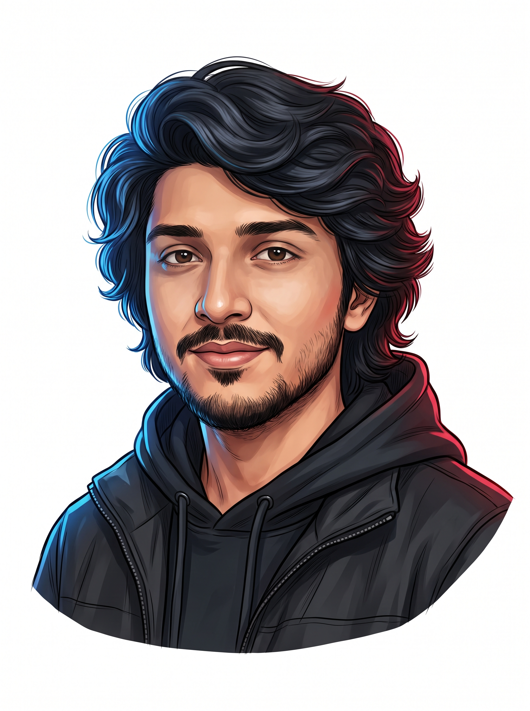
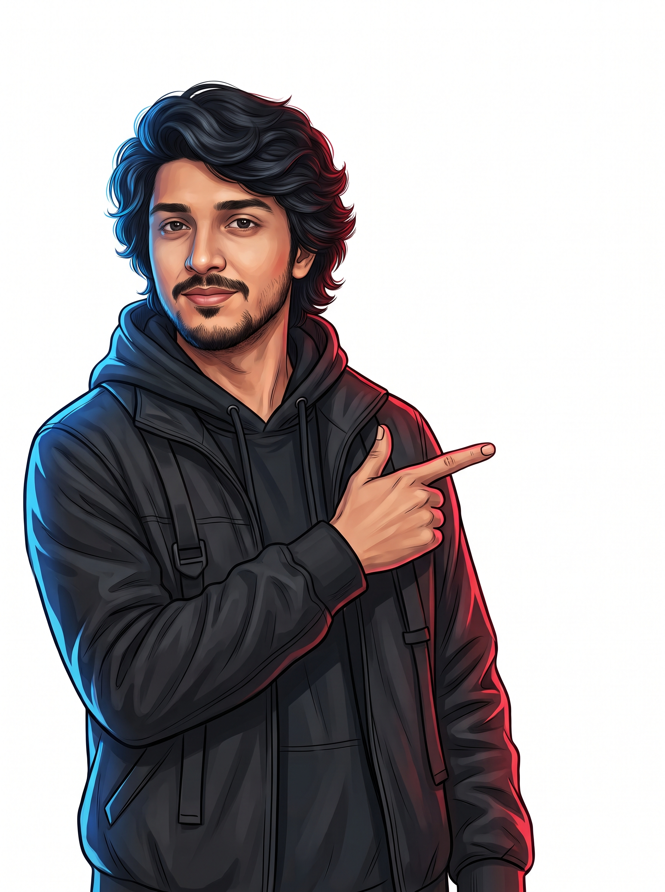

<div align="center">

<!-- TOP SYSTEM STATUS BAR -->
<p align="center">
  
</p>

<!-- QUICK REACH PILL BADGES -->
<p align="center">
  <a href="https://linkedin.com/in/bakarcipher" target="_blank">
    
  </a>
  &nbsp;
  <a href="https://instagram.com/bakarcipher" target="_blank">
    
  </a>
  &nbsp;
  
  &nbsp;
  
</p>

<br/>

<!-- HERO TERMINAL + PORTRAIT COMPACT HUD -->
<table border="0" cellpadding="0" cellspacing="0" width="100%" style="background-color: #070b16; border: 1.5px solid #247bff; border-radius: 20px; overflow: hidden; box-shadow: 0 10px 30px rgba(0,0,0,0.8);">
  <tr>
    <td width="68%" align="left" style="padding: 30px; vertical-align: middle;">
      <p style="font-family: 'Fira Code', monospace; color: #247bff; font-size: 13px; margin: 0 0 12px 0; letter-spacing: 0.05em;">
        <strong>[NODE://BAKARCIPHER]</strong> ~ console.dispatch --active
      </p>
      <h1 style="color: #ffffff; font-size: 34px; margin: 0 0 8px 0; font-family: -apple-system, BlinkMacSystemFont, 'Segoe UI', sans-serif; font-weight: 800; letter-spacing: -0.02em;">
        Malik Abubakar Ali
      </h1>
      <p style="font-family: 'Fira Code', monospace; color: #38ef7d; font-size: 14.5px; margin: 0 0 14px 0; font-weight: 600;">
        ❯ Network Defense Specialist <span style="color: #8b949e; font-weight: 400; font-size: 12.5px;">// Snort, Telemetry &amp; SIEM</span>
      </p>
      <p style="color: #c9d1d9; font-size: 13.5px; line-height: 1.6; margin: 0 0 18px 0; font-family: -apple-system, BlinkMacSystemFont, 'Segoe UI', sans-serif;">
        Defensive security scholar and enterprise operations lead bridging deep packet inspection, resilient cryptography, and zero-trust service architectures.
      </p>
      <div>
        <span style="background: #11182c; border: 1px solid #247bff; color: #58a6ff; padding: 6px 12px; border-radius: 8px; font-size: 12px; font-weight: 600; font-family: monospace;">◆ Team Lead @ Ace Solutions</span>
        &nbsp;
        <span style="background: #11182c; border: 1px solid #ff354f; color: #ff7b72; padding: 6px 12px; border-radius: 8px; font-size: 12px; font-weight: 600; font-family: monospace;">◆ Riphah International Univ.</span>
      </div>
    </td>
    <td width="32%" align="center" style="padding: 24px; vertical-align: middle;">
      <div style="position: relative; display: inline-block;">
        
      </div>
    </td>
  </tr>
</table>

<br/><br/>

<!-- CREDENTIALS & PHYSICAL LANYARD SECTION -->


<br/><br/>

<!-- DEFENSIVE CAPABILITIES & LIFE CAROUSEL -->


<br/><br/>

<!-- DEFENSIVE TECHNICAL STACK & ORBITS -->


<br/><br/>

<!-- DIRECT CONNECT SECTION: CHARACTER + SOCIAL CARDS -->
<table border="0" cellpadding="0" cellspacing="0" width="100%" style="background-color: #070b16; border: 1.5px solid #247bff; border-radius: 20px; overflow: hidden; box-shadow: 0 10px 30px rgba(0,0,0,0.8);">
  <tr>
    <td width="34%" align="center" style="padding: 24px; vertical-align: bottom;">
      
    </td>
    <td width="66%" align="left" style="padding: 30px; vertical-align: middle;">
      <h3 style="color: #ffffff; font-size: 26px; margin: 0 0 8px 0; font-family: -apple-system, BlinkMacSystemFont, 'Segoe UI', sans-serif; font-weight: 700;">
        Initiate Network Handshake
      </h3>
      <p style="color: #8b949e; font-size: 13.5px; line-height: 1.6; margin: 0 0 22px 0; font-family: -apple-system, BlinkMacSystemFont, 'Segoe UI', sans-serif;">
        Open for collaborations in defensive engineering, SOC infrastructure, incident response pipelines, or secure backend architectures.
      </p>
      <p style="margin: 0 0 12px 0;">
        <a href="https://linkedin.com/in/bakarcipher" target="_blank">
          
        </a>
      </p>
      <p style="margin: 0 0 12px 0;">
        <a href="https://instagram.com/bakarcipher" target="_blank">
          
        </a>
      </p>
      <p style="margin: 0;">
        <a href="https://github.com/bakarcipher?tab=repositories" target="_blank">
          
        </a>
      </p>
    </td>
  </tr>
</table>

<br/>

</div>

---

### 🛡️ Operational Directives & Telemetry

```yaml
Operator: Malik Abubakar Ali
Clearance: Tier-1 Defensive Operations
University: Riphah International University (Cyber Security)
Enterprise: Team Lead @ Ace Solutions
Specializations:
  - Intrusion Detection & Traffic Analytics (Snort, Wireshark, Nmap)
  - Cryptographic Systems & Key Exchange (AES-GCM, Modular Matrix Encryption)
  - Defensive Microservices (FastAPI, WebSockets, Python, SQL)
Recreation:
  - Adversarial CTFs & Security War Games
  - Portrait Photography & Visual Composition
  - Gastronomic Exploration across Rawalpindi
